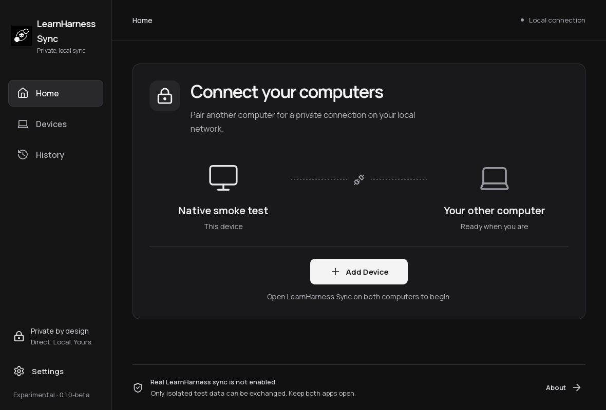
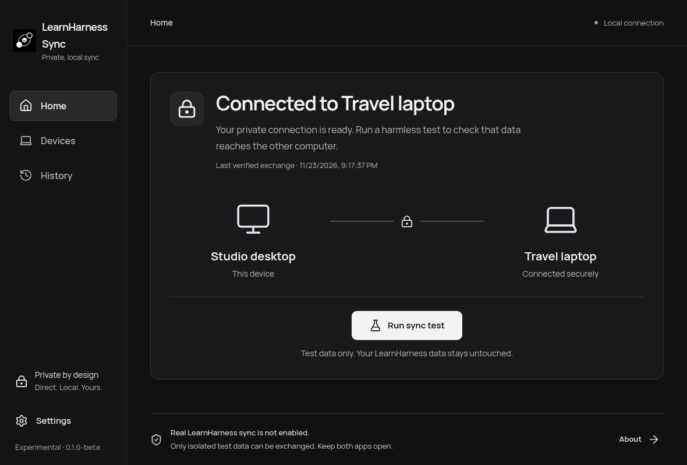

# LearnHarness Sync


Unofficial, local-first synchronization companion for LearnHarness.

LearnHarness Sync is an independent, unofficial companion application for LearnHarness. It is not affiliated with or endorsed by the LearnHarness developers.

**Experimental Linux x86_64 desktop.** For the pinned LearnHarness 0.6.1 AppImage, LearnHarness Sync supports explicitly consented transfers between isolated managed profiles. Incoming content stays quarantined until the user applies it; completion requires reopening LearnHarness and verifying application readback. No public binary is offered while physical-device acceptance and dependency redistribution reviews remain open. [Release status](https://github.com/tenkejj/learnharness-sync/releases) · [Upstream project](https://github.com/amosblomqvist/learnharness)



## Build the Linux candidate

No public binary is offered while the production writer-exclusion and dependency-redistribution gates remain open. Build the three private qualification installers from this checkout. From a directory containing all three installers and their matching SHA256SUMS file, run these commands on each computer.

```sh
sha256sum -c SHA256SUMS
chmod u+x LearnHarness-Sync_0.2.0-alpha.1_amd64.AppImage
./LearnHarness-Sync_0.2.0-alpha.1_amd64.AppImage
```

On Ubuntu, install the locally built DEB with `sudo apt install ./LearnHarness-Sync_0.2.0-alpha.1_amd64.deb`. On Fedora, use `sudo dnf install ./LearnHarness-Sync-0.2.0-alpha.1-1.x86_64.rpm`. Launch **LearnHarness Sync** from the application menu. The private packages were exercised in Ubuntu 24.04.5 and Fedora 44 userlands. Other architectures and Windows/macOS installers remain unqualified. [Second-computer instructions](docs/SECOND_COMPUTER.md)

## Pair and verify a transfer

1. Open the same candidate on both computers on the same LAN. Choose **Add Device** on both, then **Pair** beside the other computer.
2. Compare all eight groups of the verification string on both screens, in person or over a trusted channel. Approve on both computers when every group matches.
3. On Home, select **Run sync test**. Leave both desktops open until the sender reports the receiver's verified revision. History shows transfers, backups and preserved conflicts.



Each installation creates its own Ed25519 identity. Local discovery helps find peers. The trust store pins the approved certificate. The receiver checks each object's SHA-256 digest and the revision's ancestry. A fast-forward preserves the old head in an independent backup. Offline edits can create two branches, which remain available for inspection. There is no automatic conflict merge. [Protocol](docs/PROTOCOL.md) · [Recovery](docs/RECOVERY.md)

## Synchronize managed LearnHarness profiles

1. Install the exact LearnHarness 0.6.1 x86_64 AppImage at `~/Applications/LearnHarness-0.6.1-x86_64.AppImage` on both computers and pair the two LearnHarness Sync installations.
2. In Settings, open **Managed LearnHarness**. Create or use content in this separate offline profile, then close LearnHarness cleanly. Your ordinary LearnHarness profile is not opened or changed.
3. Select the paired device, check the authorization box, and choose **Send verified copy**. A verified transfer means the receiver has content in quarantine; it does not mean its application profile changed.
4. On the receiver, check the revision-specific authorization box and choose **Apply verified revision**. LearnHarness Sync makes an independent backup, applies inside the managed vault, and asks you to reopen and cleanly close LearnHarness to confirm readback.
5. Repeat in the opposite direction for new content from the second managed profile.

Only the verified 0.6.1 profile contract is accepted. Unsupported files, records or conflicting edits stop the operation. See [the packaged A→B→A and recovery evidence](docs/PRODUCTION_SYNC_ACCEPTANCE.md).

## LearnHarness compatibility

At startup the desktop checks the executable at `~/Applications/LearnHarness-0.6.1-x86_64.AppImage` against the exact size and digest of the upstream release. Home and Settings report the result. The real-data workflow only runs against this pinned executable inside its isolated managed profile. [Pinned upstream release](https://github.com/amosblomqvist/learnharness/releases/tag/v0.6.1)

| | Verified scope |
|---|---|
| Installed desktop | Pinned executable detection, isolated managed sessions, consented real-data export, quarantine, backed-up Apply and application readback, plus LAN pairing and synthetic test revisions |
| Verified managed contract | Version 2 teach/practice sessions, Unicode titles, plain-text user and assistant turns with the tested keyless provider, turn metadata, graph propositions, single- and multi-premise chains, message provenance, coverage and saved layout |
| Excluded from the wire | Device settings, credentials, Electron state, caches and logs. Unknown durable records, jobs, plugins and attachments cause refusal. Text that users put in a message is still message content. |
| Unqualified | Unmanaged writable profiles, arbitrary models and tools, imported notes, historical graph compaction, cold power loss and two-physical-laptop acceptance |

To check a backup, open **Settings → Advanced → Check a LearnHarness backup** and enter the absolute path to its read-only Btrfs subvolume root. The desktop reports counts of supported sessions, propositions and chains. Jobs, unsupported provider records, unknown files and attachments stop inspection. Records stay on the computer. The inspector does not read device settings or credentials and has a 16 MiB input limit.

### How a managed profile protects edits

In Settings, choose **Open managed LearnHarness**. The launcher verifies a private copy of the pinned executable and creates a dedicated Btrfs vault. It requires existing subordinate UID/GID allocations, rootless user namespaces, bubblewrap, util-linux, btrfs-progs and xauth. Wayland requires rootful Xwayland. An X11 session requires Xephyr.

The window runs offline with a private display and HOME. A clean exit saves a read-only generation. Each later launch edits a new writable snapshot. Settings offers recovery to the last clean generation after an abnormal exit and retains the interrupted tree separately. Btrfs generations share one storage device.

A subordinate UID owns the profile under a mode-0700 directory. The kernel denies an ordinary desktop process access even if it knows the path. A private PID namespace contains the application and its server. Capture and apply require the managed operation lock. An interrupted supervisor leaves the profile quarantined.

The packaged native adapter captures a closed managed profile, records which revision the application last opened, and compares it with incoming history. It verifies a complete independent backup and staged tree before an atomic directory exchange. The real application reopens the result before the desktop confirms adoption. The migration test starts from a separate, disposable installation and a read-only Btrfs backup. The desktop exposes no live-profile migration button. [Qualification and boundaries](docs/MANAGED_LINUX.md)

## Troubleshooting

- **Device missing** — Open Add Device on both machines. If multicast is unavailable, use **Can’t find your computer?** to exchange the invitation. Both devices still verify the full string.
- **Offline or interrupted transfer** — Reopen the same build on both computers and check Settings → Advanced → Diagnostics. Keep the full profile and its history.
- **Conflicting revisions** — Open History and inspect both branches. A newer timestamp does not establish which branch contains the desired changes.
- **AppImage fails to mount** — Try `./LearnHarness-Sync_0.2.0-alpha.1_amd64.AppImage --appimage-extract-and-run`, or use the matching distribution package.
- **LearnHarness detected but sync unavailable** — Detection and managed QA qualify different capabilities. Keep using the original LearnHarness installation normally. [Installation and diagnostics](docs/INSTALL.md)

## Build and test

Use stable Rust, Node.js 22+, npm and the Linux Tauri 2 GTK/WebKit development and packaging prerequisites. The frontend uses React and the packaged Manrope font. The native application runs in one Tauri process. Python supports development tests.

```sh
git clone https://github.com/tenkejj/learnharness-sync.git
cd learnharness-sync
npm ci
npm run lint && npm run format:check && npm test && npm run build
cargo test --locked --workspace --all-features
npm run test:peers
npm run test:ui
scripts/build-linux-candidates
```

Bundles appear in `target/release/bundle/`. Use `npm run desktop` for development. Run the real LearnHarness suite on a supported Linux test host with the pinned AppImage and the additional isolation prerequisites. [Managed test instructions](docs/MANAGED_LINUX.md) · [Physical LAN acceptance](docs/TWO_DEVICE_ACCEPTANCE.md)

## Contributing, security and license

Changes to the profile contract need a real application readback test. Use disposable profiles for reproduction. Report security issues privately to the maintainer and exclude device keys, transcripts and provider credentials. Independent software source uses MIT. The authorized project artwork has separate terms. [Contributing](CONTRIBUTING.md) · [Security](SECURITY.md) · [MIT license](LICENSE) · [Artwork and dependency notices](NOTICE)
